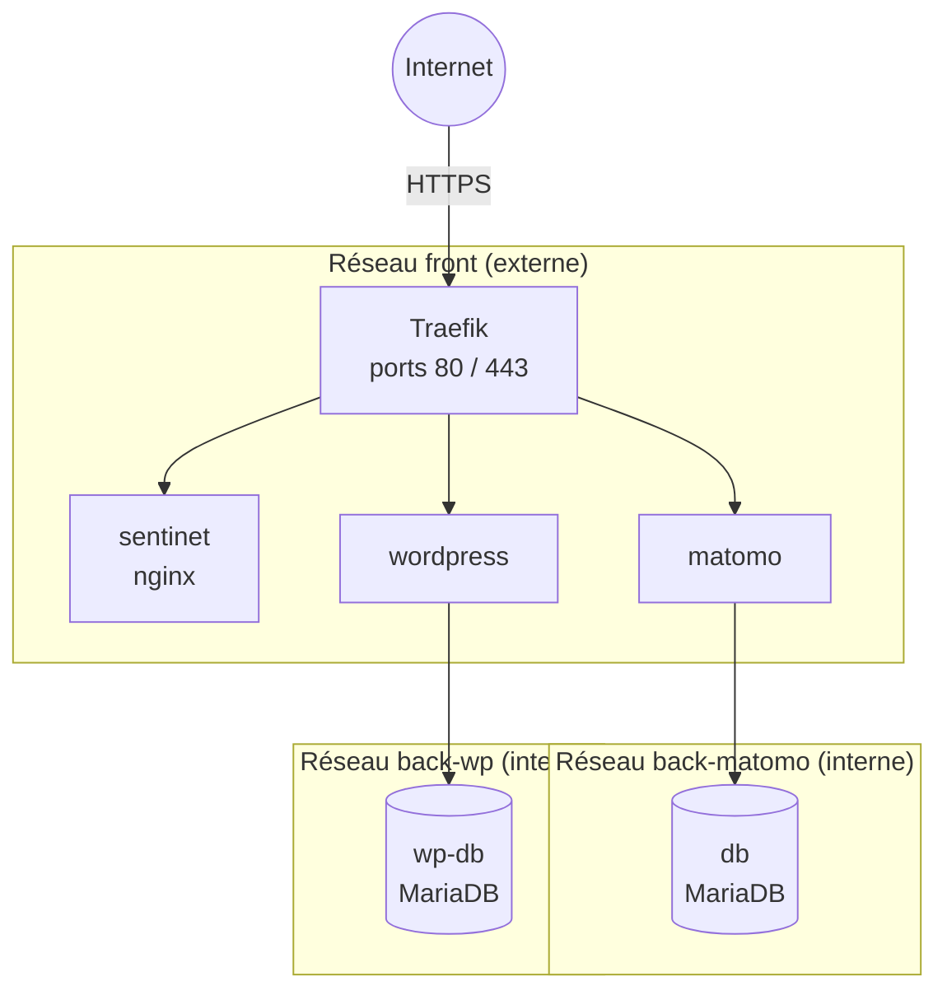

# SentiNet

Lancer les sites

* Créer le fichier d'environnement, puis remplacer les mots de passe d'exemple et le token Cloudflare :

```
cp .env.example .env
```

* Créer le réseau partagé de Traefik (une seule fois) :

```
docker network create front
```

* Construire et démarrer :

```
docker compose build
docker compose up -d
```

Sites

* `https://sentinet.sophiaplustech.com` : site statique SentiNet.
* `https://matomo-sentinet.sophiaplustech.com` : statistiques Matomo. Suivre l'assistant d'installation au premier lancement.
* `https://wp-sentinet.sophiaplustech.com` : WordPress. Suivre l'assistant d'installation au premier lancement.

Les certificats HTTPS sont générés automatiquement par Traefik via Let's Encrypt (challenge DNS Cloudflare). Les 3 sous-domaines doivent pointer vers l'IP du serveur.

Architecture réseau



* `front` : seul réseau exposé. Traefik reçoit tout le trafic et le route vers le bon site selon le domaine.
* `back-matomo` et `back-wp` : réseaux internes, sans accès Internet. Chaque base n'est joignable que par son application.
* Matomo et WordPress sont sur 2 réseaux : `front` pour recevoir les requêtes, `back-*` pour parler à leur base.
* Matomo ne peut pas joindre la base WordPress, et inversement.

Commandes utiles

```
docker compose ps              # état des conteneurs
docker compose logs -f         # logs
docker compose up -d --build   # appliquer une modification
docker compose down            # arrêter
```

> Ne jamais lancer `docker compose down -v` : cela supprime les bases de données.